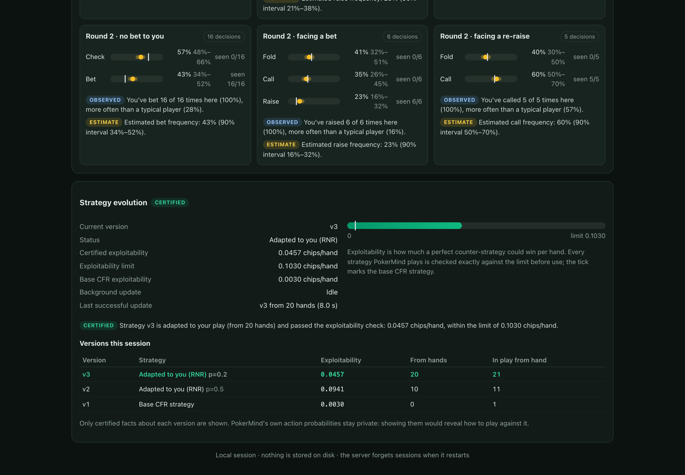

# PokerMind

**A local poker AI that learns how you play, and exploits it only within an
exactly verified safety limit.**

PokerMind plays heads-up **Leduc Hold'em** (a small research poker game)
against you in the browser.
* **It starts unbeatable-ish.** Its baseline is a near-equilibrium strategy
  computed with Counterfactual Regret Minimization (CFR).
* **It watches you.** A Bayesian model estimates how often you fold, call
  and raise in each betting situation.
* **It adapts safely.** Periodically, in the background, it re-solves its
  strategy with Restricted Nash Response. A new strategy goes into play only
  after its exploitability has been computed **exactly** and found within a
  fixed limit.
* **It explains itself.** A dashboard shows what it observed, what it
  estimates (with uncertainty), and every certified strategy version.



## At a glance

| | |
|---|---|
| **Guarantee** (exact, checked by computer) | Every strategy the AI plays loses at most **0.1030 chips/hand** to a perfect counter-strategy; the CFR baseline is at 0.0030. |
| **Measured** (simulated opponents, 95 % CIs) | After 100 hands, safe adaptation gains **+0.131 chips/hand** over the baseline on held-out opponents, vs +0.016 for a simpler mixing method. Up to **+0.619** on unfamiliar styles. A calibrated confidence rule cut losing runs from 6.7 % to 2.3 %. |
| **Not claimed** | Results against real human players; anything about Texas Hold'em. |
| **Engineering** | Python 3.12, NumPy, FastAPI, Next.js 16 / React 19 / TypeScript. 520 Python and 36 frontend tests, strict MyPy, 20 cross-checks against DeepMind's OpenSpiel. |

The plain-language story, with links to every result:
**[docs/overview.md](docs/overview.md)**.

## Quick start (macOS)

**Requires** Python 3.12, Node.js ≥ 20.9 (≥ 22 for the screenshot script)
and about 600 MB of disk (about 1.5 GB with the `[dev]` extra, which includes PyTorch).

```bash
# one-time setup
python3.12 -m venv .venv
.venv/bin/pip install -e ".[app]"         # add [dev] for tests and research tools
(cd web && npm ci)
.venv/bin/pokermind launch --train-hero   # trains the frozen CFR hero, ~30 minutes, once

# every time
.venv/bin/pokermind launch                # then open http://localhost:3000; Ctrl-C stops everything
```

* **What `pokermind launch` does:**
  * checks Python, Node.js, the dependencies, the frozen configuration and
    the hero's digest, and the ports;
  * builds the web app when needed;
  * starts the backend and the web app;
  * prints the URL.

  Every failure message includes the fix. Ctrl-C stops both services,
  including background solver processes.
* **Options:**
  * `--demo` re-solves every 10 hands instead of 50 (for recordings);
  * `--api-port` and `--web-port` change the ports;
  * `--open` opens the browser;
  * `--rebuild` forces a fresh web build.
* **Logs:** `runs/launch/`.

**Recording a demo:** see [docs/demo.md](docs/demo.md).
**Release status:** see [docs/release/v1.md](docs/release/v1.md).

## Documentation

| for | read |
|---|---|
| a quick understanding | [docs/overview.md](docs/overview.md): the problem, CFR, opponent modelling, RNR, certification, results, limits |
| a demo | [docs/demo.md](docs/demo.md): recording plan, narration, real screenshots |
| the frozen research baseline | [docs/research/research_freeze.md](docs/research/research_freeze.md) and [configs/pokermind-research-v1.json](configs/pokermind-research-v1.json) |
| the measured results | `docs/experiments/` (one file per milestone, with reproduction commands) |
| the app | [docs/design/app_backend.md](docs/design/app_backend.md) (API contract), [web/README.md](web/README.md) |
| concepts | [docs/concepts/cfr.md](docs/concepts/cfr.md), [docs/concepts/neural_policy.md](docs/concepts/neural_policy.md), [docs/games/leduc.md](docs/games/leduc.md) |

## How it was built

| milestone | what it added | where the evidence is |
|---|---|---|
| M0–M1 | Kuhn Poker engine; vanilla CFR with exact evaluation (exploitability 0.0010, game value matched to 4e-7) | `docs/concepts/cfr.md` |
| M2A–M2B | tiny neural policies distilled from CFR; training stability | `docs/experiments/m2b_results.md` |
| M3–M4 | generic game interface, Leduc, CFR hero (0.0030); neural generalisation (not adopted) | `docs/experiments/m4_leduc_neural.md` |
| M5 | Bayesian opponent model from public actions | `docs/experiments/m5_opponent_modeling.md` |
| M6 | adaptation within an exact exploitability budget | `docs/experiments/m6_adaptive_strategy.md` |
| M7A–M7B | Restricted Nash Response; calibration; research freeze v1 | `docs/experiments/m7a_robust_response.md`, `m7b_adaptive_reliability.md` |
| M8A–M8C | FastAPI backend, web app, learning dashboard | `docs/design/app_backend.md`, `web/README.md` |
| M9 | one-command launcher, portfolio docs, release verification | `docs/release/v1.md` |

## Technical reference

### Layout

```
src/pokermind/
  games/kuhn.py          immutable config/state/info-state, rules, payoffs
  games/base.py          M3 game interface: Game, GameState, Observation, chance nodes
  games/kuhn_game.py     Kuhn behind the interface (adapter over games/kuhn.py)
  games/leduc.py         Leduc Hold'em, matching OpenSpiel's leduc_poker
  agents/                Agent protocol, random/rule baselines, StrategyAgent (CFR)
  strategy.py            tabular strategy type and JSON file format
  learning/cfr.py        vanilla CFR for Kuhn (M1, kept as regression reference)
  learning/game_cfr.py   vanilla CFR for any Game (M3)
  evaluation/exact.py    exact EV, best response, NashConv, exploitability (Kuhn, M1)
  evaluation/game_exact.py  the same for any Game (M3)
  evaluation/reference.py known Kuhn equilibrium family, game value -1/18
  neural/                M2A: encoding, teacher dataset, masked MLP, training, agent
  neural/leduc_*.py      M4: Leduc encoding, canonical dataset and splits, neural agent
  neural/game_*.py       M4: size-agnostic policy network; training with validation
  opponents/             M5: public contexts/records, simulated opponent population,
                         exact public-context marginals, Dirichlet opponent model, CUSUM
  adaptive/              M6: card-conditional policy reconstruction (latent-card EM, Gibbs),
                         hero best responses, realization mixtures, exploitability budgets
  robust/                M7A: compiled game tree, vectorized restricted CFR(+), Restricted
                         Nash Response and Data-Biased Response, explicit RNR game;
                         M7B: batched RNR solver and evaluator (batch.py), budgeted
                         uncertainty-aware selection (selection.py)
  research.py            M7B: versioned research configuration and digest
  app/                   M8A: verified context, Leduc sessions, background certified
                         strategy updates, session store, FastAPI adapter (api.py)
  launcher.py            M9: `pokermind launch` (checks, build, supervised start/stop)
  experiments/           CFR and neural-distillation runners, metrics and plots
  simulation/runner.py   seeded batch runner, metrics, result digest
  simulation/metadata.py reproducibility metadata (versions, platform, git)
  cli.py                 `pokermind` command
tests/                   rules, payoffs, leakage, agents, simulation, CLI,
                         CFR, evaluation oracle, OpenSpiel cross-check (optional)
docs/kuhn_poker.md       rules and state representation
docs/concepts/cfr.md     CFR, best response and exploitability, worked example
docs/concepts/neural_policy.md  layers, backprop, Adam, softmax, KL, distillation
docs/experiments/        frozen M2A results, M2B stability/capacity/benchmark results
docs/design/leduc_interface.md  game interface design and what M3 implemented
docs/games/leduc.md      Leduc rules, action aliases, turn order, information sets
docs/design/leduc_encoding.md  M4 features, suit canonicalization, splits
docs/experiments/m4_leduc_neural.md  M4 results
docs/design/opponent_modeling.md  M5 observability, contexts, model, evaluation, leakage
docs/experiments/m5_opponent_modeling.md  M5 results
docs/design/adaptive_strategy.md  M6 reconstruction, mixtures, budget, protocol
docs/experiments/m6_adaptive_strategy.md  M6 results
docs/design/robust_response.md  M7A RNR/DBR, guarantees, approximations, selection
docs/experiments/m7a_robust_response.md  M7A results
docs/experiments/m7b_adaptive_reliability.md  M7B convergence, calibration, speed, robustness
docs/research/research_freeze.md  M7B frozen architecture, evidence, reproduction
configs/pokermind-research-v1.json  frozen research configuration (digest-checked)
docs/design/app_backend.md  M8A architecture, gameplay rules, update safety, API contract
research/                experiment notebooks/scripts (kept apart from the package)
web/                     M8B/M8C: Next.js web interface and dashboard, see web/README.md
web/scripts/capture-screenshots.mjs  M9: real-session screenshots via headless Chrome
docs/overview.md, docs/demo.md, docs/release/v1.md  M9: portfolio overview, demo, release
docs/screenshots/        M9: screenshots from a real session
```

Dependency direction: `games` ← `strategy` ← {`agents`, `learning`,
`evaluation`} ← `neural` ← `simulation` ← `experiments` ← `cli`. Only `neural`
and its experiment import PyTorch, lazily from the CLI. Games know nothing about
agents or learning. Agents only see `InfoState`. The evaluator never imports
the learning code, so it is an independent check on CFR.

### Development setup (Apple Silicon, Python 3.12)

```bash
python3.12 -m venv .venv
source .venv/bin/activate
pip install -e ".[dev]"
```

### Research commands

```bash
pokermind agents
pokermind simulate --agents random rule --hands 100000 --seed 42
pokermind simulate --agents rule always-bet --hands 10000 --seed 7 --output runs/rule_vs_bet.json
python -m pokermind simulate --json --hands 1000

# M1: train CFR, evaluate exactly at checkpoints, export strategies and plots
pokermind train-cfr --output-dir runs/m1-cfr --seed 0
pokermind simulate --agents cfr rule --strategy runs/m1-cfr/strategies/strategy_050000.json

# M3: CFR on Leduc Hold'em (or Kuhn) through the generic game interface
pokermind train-cfr --game leduc --output-dir runs/m3-leduc-cfr
pokermind train-cfr --game kuhn --engine generic   # reproduces M1 bit for bit

# M4: a stronger Leduc teacher, then neural distillation and generalization splits
pokermind train-cfr --game leduc --checkpoints 1000 10000 20000 50000 100000 \
    --output-dir runs/m4-leduc-teacher
pokermind leduc-neural --teacher runs/m4-leduc-teacher/strategies/strategy_100000.json \
    --comparison-teacher runs/m3-leduc-cfr/strategies/strategy_010000.json

# M5: learn simulated opponents' tendencies from public actions (hero = M4 teacher)
pokermind opponent-study --hero runs/m4-leduc-teacher/strategies/strategy_100000.json

# M6: adapt to observed opponents within an exact exploitability budget (multi-process)
pokermind adaptive-study --hero runs/m4-leduc-teacher/strategies/strategy_100000.json

# M7A: RNR and DBR vs the M6 mixture at equal exact exploitability budgets (multi-process)
pokermind robust-study --hero runs/m4-leduc-teacher/strategies/strategy_100000.json

# M7B: solver convergence, calibration (development opponents), frozen held-out
# evaluation and selection benchmark; validate the frozen configuration
pokermind reliability {convergence,calibrate,evaluate,benchmark} \
    --hero runs/m4-leduc-teacher/strategies/strategy_100000.json
pokermind research-config --check

# M8A–M9: the app (pokermind launch runs both; or start them separately)
pokermind serve          # API only, http://127.0.0.1:8000/docs
cd web && npm ci && npm run build && npm run start   # web only, http://localhost:3000
```

`train-cfr` writes `metrics.json`, `metrics.csv`, `convergence.png` and one
strategy file per checkpoint into the output directory. `runs/` is
git-ignored. Exploitability is NashConv / 2 in chips per hand; the
conventions are documented in `docs/concepts/cfr.md`.

M2A: distill the CFR strategy into tiny networks (PyTorch) and evaluate them exactly:

```bash
pokermind train-neural --output-dir runs/m2a-neural
pokermind simulate --agents neural rule --model runs/m2a-neural/models/mlp16_lr0.01_seed2.pt
```

`train-neural` trains linear, 16 and 16×16 policies over several learning rates
and seeds, then reports imitation error, exact exploitability, payoffs, model
size and latency against the 12-entry table (`docs/concepts/neural_policy.md`).
Kuhn Poker has only 12 information sets, so these runs measure
representation, not generalization.

M2B: stability of training procedures, capacity sweep and latency benchmarks:

```bash
pokermind neural-study --output-dir runs/m2b
```

Results and methodology: `docs/experiments/m2b_results.md`.

Optional cross-check against OpenSpiel (not a project dependency):

```bash
pip install -e ".[crosscheck]"
pytest tests/test_openspiel_crosscheck.py tests/test_openspiel_leduc.py
```

The report includes the mean return per hand (± standard error) for each
agent and each seat, invalid-action counts, a zero-sum check, counts for each
terminal history, elapsed time, and a SHA-256 digest of every hand record.
The engine raises on any illegal transition, so a completed run has none. Use `--output` to write a JSON file that also records
the full configuration and environment metadata.

### Quality checks

```bash
pytest                                   # POKERMIND_E2E=1 adds a full launcher test
ruff check . && ruff format --check .
mypy
(cd web && npm run typecheck && npm run lint && npm test && npm run build)
```

### Engineering principles

* Environments, agents, learning algorithms and evaluation stay independent.
* Agents never see an opponent's private cards.
* Every experiment is seeded and reproducible.
* No claim that a model improved without measured results.
