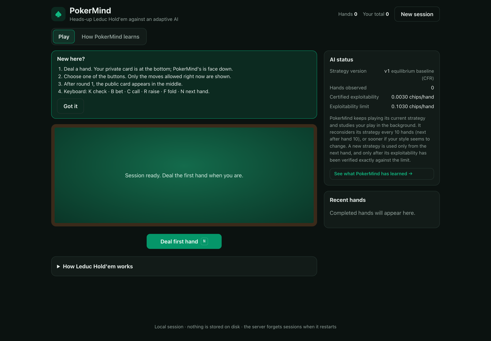
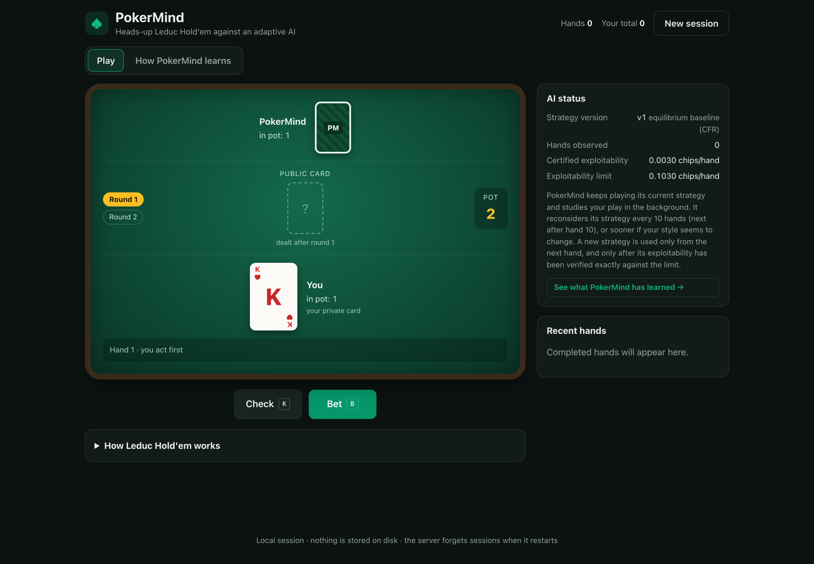
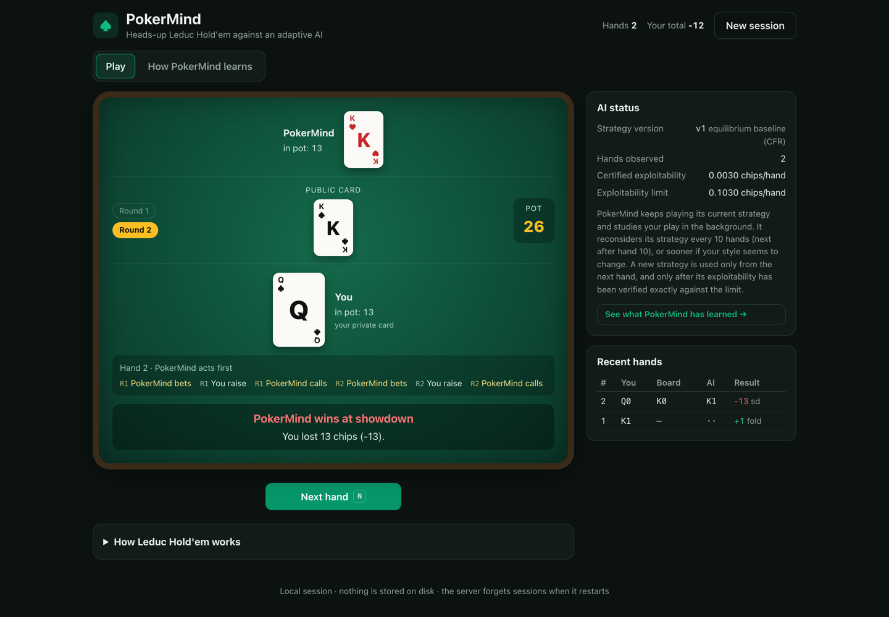
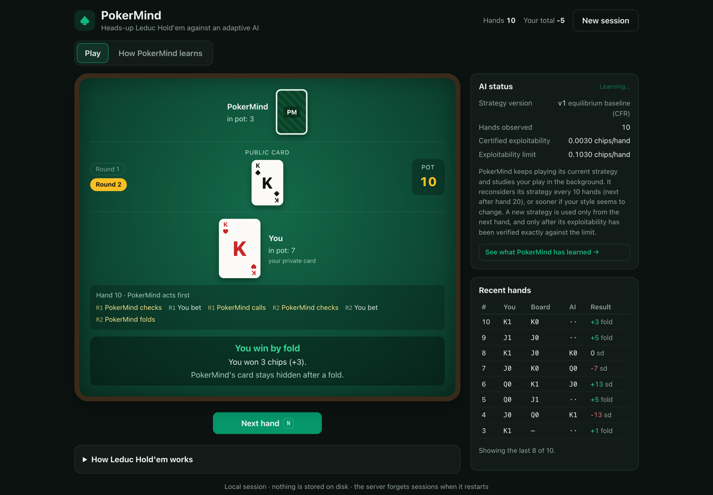
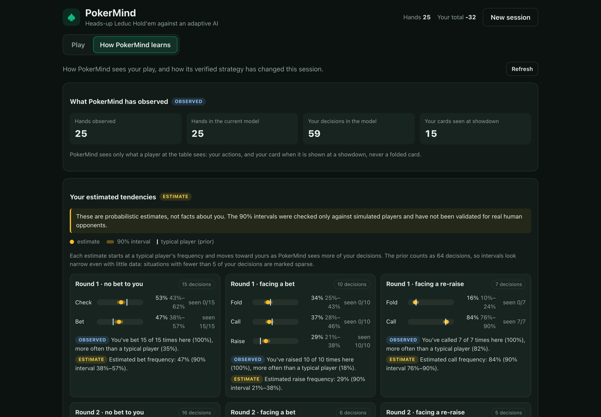
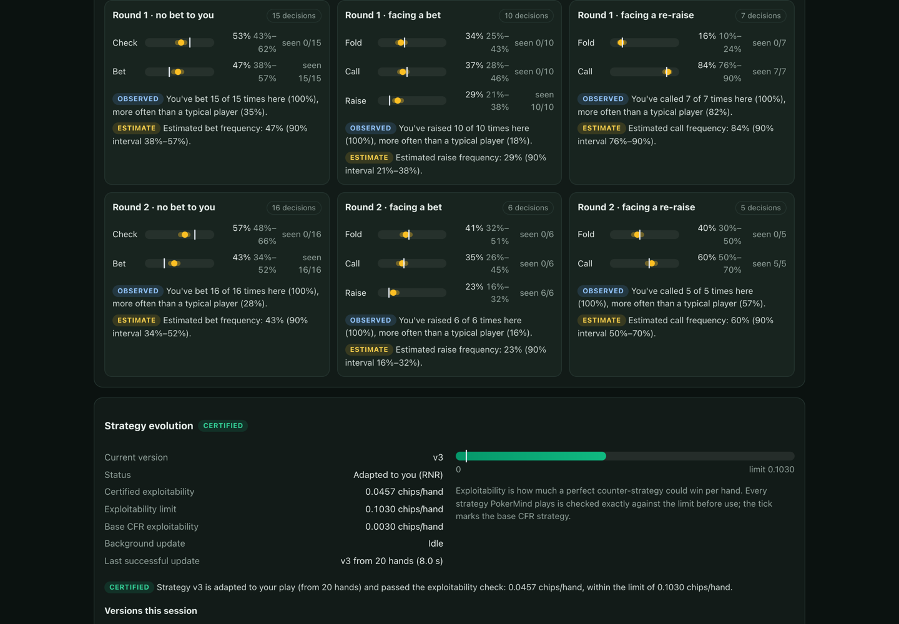
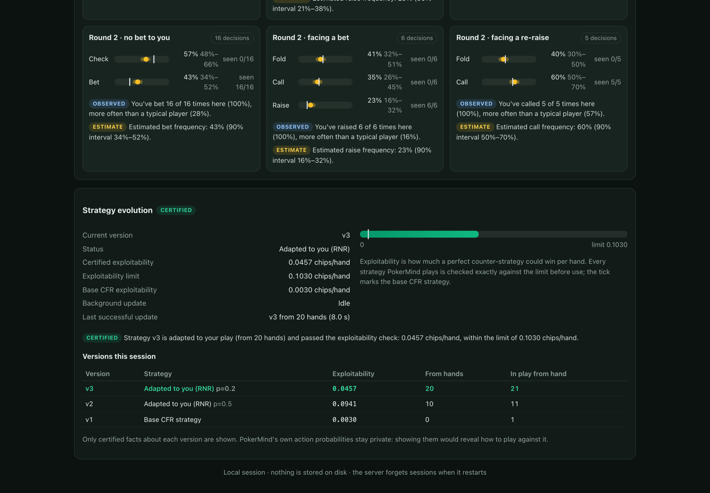
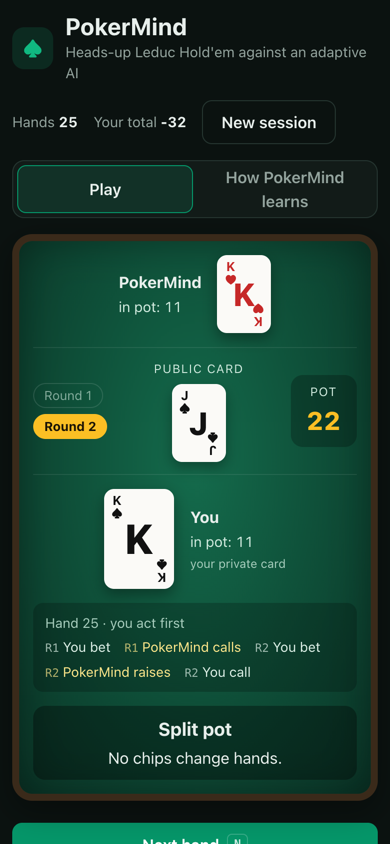

# PokerMind demo: plan, narration and screenshots

A 3–4 minute screen recording that shows PokerMind learning a player and
updating its strategy safely. It uses only the real app. Deals are random,
so every recording differs. **Narrate what actually appears on screen, not
the example values below.**

## Setup (before recording)

```bash
pokermind launch --demo     # strategy updates every 10 hands instead of 50
```

* **Demo pacing.** `--demo` only changes *how often* the AI reconsiders its
  strategy. Each update uses the same frozen algorithm and the same
  exploitability check. Say so in the recording.
* **Window.** Use a browser window of about 1440×1000 at
  `http://localhost:3000`. Hide bookmarks and extensions, and use a fresh
  profile or a private window so the first-time guide appears.
* **Optional reset.** To start from a clean state, restart the launcher:
  sessions live in memory.

## Recording sequence

| # | Action on screen | Narration (adapt to what appears) | ~time |
|---|---|---|---|
| 1 | Start page → **Start a new session** | "PokerMind plays Leduc Hold'em, a small research version of poker, against me. It starts from a near-equilibrium strategy computed by CFR, so it's very hard to beat, and then it watches how I play." | 0:20 |
| 2 | Point at the first-time guide, then **Got it** and **Deal first hand** | "My private card is at the bottom. PokerMind's card is face down, and the server never sends it to the browser unless there's a showdown. The public card arrives after round 1." | 0:20 |
| 3 | Play 3–4 hands, mostly **Bet**/**Raise**; show one showdown and one fold | "I'm deliberately playing aggressively. Only legal moves are offered. They come from the server, which also settles every pot. The log shows exactly what happened: check, bet, call, raise." | 0:45 |
| 4 | Point at **AI status**: v1, certified 0.0030, limit 0.1030 | "This is the safety budget. Exploitability is how much a perfect opponent could win per hand. The baseline is 0.003, and PokerMind will never play anything above 0.103, whatever it believes about me." | 0:20 |
| 5 | Keep playing to hand 10; **Learning…** appears | "After ten hands it starts recomputing its strategy in the background. I can keep playing. It keeps using the verified strategy until the new one passes the check." | 0:25 |
| 6 | Open **How PokerMind learns** → observed counts and tendencies | "Here's what it has observed. In this situation I bet every time. The yellow dot is its estimate, the bar its 90 % interval, and the white tick a typical player. With little data the estimate stays near the typical player. The 'sparse' badges and the disclaimer make clear these are estimates, not facts about me, and that the intervals haven't been validated against real humans." | 0:40 |
| 7 | Scroll to **Strategy evolution** | "Here's the strategy history. Version 2 is adapted to me with Restricted Nash Response, and its exploitability was certified exactly, below the limit. If the model hadn't been confident, it would have kept the baseline and said so." | 0:30 |
| 8 | (Optional) play to hand 20 for a second update | "Each update is computed from all hands so far and checked again before use." | 0:20 |
| 9 | Close on the dashboard | "Everything here is reproducible, and the safety bound is a mathematical guarantee. What's still open is whether this beats real people. That's untested." | 0:15 |

**Do not say** that PokerMind "beats humans", "reads your cards", "plays
Texas Hold'em", or that a change in an estimate means the AI changed its
play. It changes play only when a new certified version is installed.

## Screenshot gallery (real session)

Captured on 2026-11-15 by `web/scripts/capture-screenshots.mjs`. The script
drives the installed Chrome with real mouse and keyboard input against
`pokermind launch --demo`.
* The scripted player bets or raises whenever that is legal, and otherwise
  calls.
* Everything shown (cards, results, estimates, versions, exploitability) is
  what that session produced. Nothing was edited.
* The player finished 25 hands at −32 chips. That is a single random
  session, not a performance measurement.

| | |
|---|---|
|  **1. New session** with first-time guidance and the AI status panel. |  **2. First hand**: private card, face-down AI card, empty public-card slot, legal actions only. |
|  **3. A completed hand** with the result and the recent-hands table. |  **4. "Learning…"** after hand 10, while v1 keeps playing. |
|  **5. Dashboard**: observed counts and the estimate disclaimer. |  **6. Tendencies**: estimate, 90 % interval, typical-player prior, observed counts. |
|  **7. Strategy evolution**: v1 baseline → v2 (RNR, p = 0.5, certified 0.0941) → v3 (p = 0.2, certified 0.0457), all within 0.1030. |  **8. Mobile layout**. |

To capture your own set:

```bash
pokermind launch --demo                       # terminal 1
node web/scripts/capture-screenshots.mjs      # terminal 2 (Chrome, Node.js >= 22)
```
